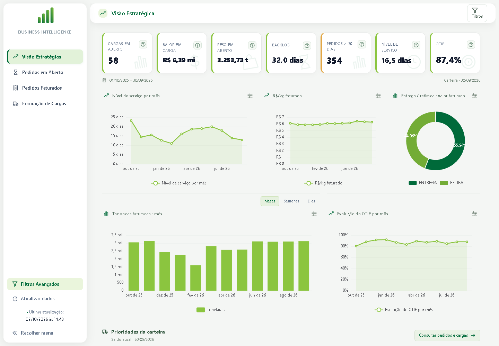
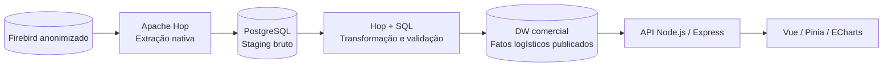

# Business Intelligence aplicado à logística: desenvolvimento de um painel analítico para apoio à tomada de decisão com dados de um ERP

Parte prática do Trabalho de Conclusão de Curso: **desenvolvimento de um painel analítico para apoio à tomada de decisão com dados de um ERP**.

O projeto organiza dados do ERP Firebird em uma base analítica PostgreSQL, por meio do Apache Hop, e apresenta indicadores e consultas em uma aplicação web. O foco é acompanhar a carteira de pedidos, as parcelas em carga e sem carga e o desempenho do faturamento.

**Autor:** Guilherme Diniz Queiroz · **Repositório:** [GuilhermeDQueiroz/tcc](https://github.com/GuilhermeDQueiroz/tcc)



*Captura da publicação local validada, com referência de carteira em 30/09/2026. Os valores da imagem pertencem àquela publicação; não são constantes nem dados fornecidos pela interface.*

## Funcionalidades

| Área | Análises disponíveis |
|---|---|
| Visão Estratégica | Sete indicadores, cinco gráficos, filtros de localização/modalidade/período e quatro prioridades com acesso aos pedidos |
| Formação de Cargas | Pedidos sem carga, parcialmente e totalmente alocados; quantidades, valor, peso e cubagem por parcela; seleção cruzada entre carga, pedido e item; mapa e previsões |
| Pedidos em Aberto | Carteira, backlog, calendário, geografia, dimensões e pesquisa |
| Pedidos Faturados | Semanas, acompanhamento mensal, evolução, carteira, dimensões e pesquisa |
| Pedidos Emitidos | Área comercial preservada em sua rota, sem destaque no menu principal |

As consultas incluem filtros, totalizadores, hierarquias, pesquisa, exportação CSV e preferências locais. A aplicação adapta a disposição dos painéis para telas menores.

## Arquitetura



Há 32 projeções de fontes no fluxo comercial e quatorze no fluxo logístico. As publicações são versionadas e identificadas nos resultados. O ETL é executado separadamente; abrir o painel não inicia uma extração. A API utiliza a última publicação válida.

**Tecnologias verificadas:** Node.js 24.16.0, Vue 3, TypeScript, Pinia, Vue Router, Tailwind CSS, Apache ECharts, Express, PostgreSQL 18, Apache Hop 2.19, JDK 21, Python 3.12 e Firebird 5.

## Começar após clonar

```powershell
git clone https://github.com/GuilhermeDQueiroz/tcc.git business-intelligence-logistica
cd business-intelligence-logistica
npm ci
npm test
npm run build
```

Esses comandos verificam o código e geram a interface **sem precisar do banco da empresa ou das evidências privadas**. A aplicação não fornece registros simulados ou modo de demonstração.

Para abrir o painel com dados, siga o [guia de reprodução](docs/reproducao.md): obter a cópia Firebird anonimizada, preparar o PostgreSQL local em `localhost:5434`, configurar as conexões e executar as publicações comercial e logística pelo Hop. Depois:

```powershell
.\scripts\iniciar-dev.ps1 -BancoJaIniciado
```

| Serviço | Endereço |
|---|---|
| Aplicação compilada e API | http://127.0.0.1:3002 |
| Interface de desenvolvimento | http://127.0.0.1:5173 |
| PostgreSQL do projeto | `localhost:5434`, banco `dados` |

O launcher solicita credenciais ausentes em memória e mantém logs em `.local/runtime`. Para encerrar os processos que ele iniciou, use `scripts/parar-dev.ps1`. A instância PostgreSQL tem comandos próprios em `banco/scripts`.

## Dados e configuração

A fonte da parte prática é uma **cópia Firebird anonimizada**, que deve ser obtida com o autor por meio separado. O repositório contém código, consultas, metadados, pipelines, workflows e documentação; não contém o arquivo Firebird, o cluster PostgreSQL, dumps, senhas ou referências privadas de validação. O arquivo local completo tem cerca de 98 GB e não integra o histórico Git.

Copie `.env.example` para `.env` e configure apenas o arquivo local. As conexões Hop usam variáveis; nenhum segredo deve ser gravado nos metadados. Metas comerciais reais também ficam fora do versionamento: em um clone novo, as metas começam sem valores definidos. A configuração pública com zeros não fornece dados do ERP.

## Verificação

| Comando | Escopo e pré-requisitos |
|---|---|
| `npm test` | Perfil público: contratos, datas, cache, filtros, relações, indicadores estratégicos, configurações e organização estática do ETL; sem banco |
| `npm run build` | Verificação TypeScript/Vue e compilação da interface |
| `npm run check:repository` | Inspeção dos arquivos no índice Git contra as regras de arquivos privados, tamanho e credenciais |
| `npm run check` | Perfil público, build e inspeção do índice |
| `npm run test:etl` | Linhagem e estrutura nativa do Hop; exige Python, sem conectar aos bancos |
| `npm run test:real` | Suíte completa, incluindo equivalência com referências privadas reais; exige ambiente e evidências descritos no guia |
| `npm run test:ui` | Navegação e interface com Chrome e API real ativa |

Os pequenos casos controlados dos testes públicos exercitam regras e falhas; não alimentam o painel nem representam observações da empresa. O perfil real compara publicações e referências executadas sobre dados reais. Novos arquivos de teste precisam de classificação explícita; nenhum perfil é escolhido pela existência acidental dos dados locais.

A [CI](.github/workflows/ci.yml) executa a verificação pública em pushes e pull requests. Ela não extrai dados nem executa testes gerenciais. Veja [o escopo de validação e suas evidências](docs/validacao-entrega-git.md).

## Definições e limites do TCC

- **Nível de Serviço / Lead Time:** tempo médio até faturamento, com média por registro; não confirma entrega ao cliente.
- **OTIF:** convenção interna de pontualidade de faturamento. A regra atual e a cobertura de previsão são exibidas; não comprova entrega física nem In Full.
- **Pedidos antigos:** idade da carteira, distinta de previsão vencida.
- **Backlog estratégico:** valor aberto dividido pela média diária de faturamento dos 90 dias corridos da referência; difere do recorte de status do backlog comercial.
- **R$/kg:** valor dos produtos faturados por massa; não é custo de frete.
- **Mapa:** distribuição geográfica; não há otimização de rotas.

Frete sobre faturamento, assistência/recolhimento como processos próprios, duração por etapa e histórico real do saldo permanecem no plano de evolução. O experimento manual × painel e a avaliação com gestores ainda precisam ser aplicados. Testes técnicos não demonstram, isoladamente, ganho de produtividade gerencial.

## Documentação para a banca

- [Reprodução do ambiente e das publicações](docs/reproducao.md)
- [Roteiro de demonstração e avaliação](docs/entrega-pratica-tcc.md)
- [Correspondência entre implementação e monografia](docs/relacao-com-tcc.md)
- [Dicionário de indicadores](docs/dicionario-indicadores-logisticos.md) e [regras de negócio](docs/regras-negocio-logistica.md)
- [Fontes, telas, testes e capítulos do TCC](docs/mapeamento-fontes-logisticas.md)
- [Visão Estratégica](docs/visao-estrategica-logistica.md) e [Formação de Cargas](docs/formacao-cargas-analise-operacional.md)
- [Plano de implementação e pendências](docs/plano-implementacao-logistica-tcc.md)
- [Validação de equivalência com o legacy](docs/validacao-equivalencia.md)

## Organização

```text
api-server/    API, repositórios e cálculos
src/           Interface, filtros, gráficos e consultas
etl/           Pipelines, workflows, metadados e SQL do Apache Hop
banco/         Instruções e scripts da instância PostgreSQL
scripts/       Execução e verificações do projeto
tests/         Testes públicos, equivalência e navegador
docs/          Contratos, metodologia, reprodução e evidências
data/          Modelo público de metas; configurações reais locais
```

## Reutilização e créditos

A licença do código autoral ainda não foi definida pelo autor. Dependências, fontes e recursos de terceiros conservam suas próprias licenças e créditos em [THIRD_PARTY_NOTICES.md](THIRD_PARTY_NOTICES.md). Dados e configurações locais não são licenciados nem distribuídos pelo repositório.

Orientações para alterações: [CONTRIBUTING.md](CONTRIBUTING.md). Para relatar problemas de exposição de informação, consulte [SECURITY.md](SECURITY.md).
