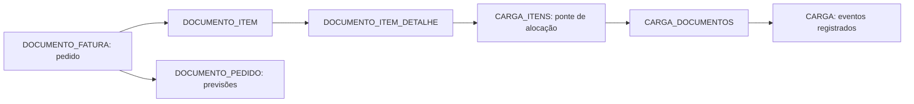

# Primeira entrega: pedidos e formação de cargas

**Ampliação posterior na mesma data:** [análise operacional com cubagem, peso, valor, previsões e geografia](formacao-cargas-analise-operacional.md). O relato abaixo preserva o escopo e as evidências da primeira entrega; o novo documento descreve o estado ampliado, com quatorze fontes.

Implementação iniciada em 2 de outubro de 2026. A rota `/cargas` utiliza a cópia anonimizada local informada pelo autor. A extração é nativa do Apache Hop; Python organiza a execução, inspeciona metadados e confere agregados, sem transferir linhas do ERP para o DW.

## Escopo efetivamente implementado

O painel apresenta pedidos sem carga, parcialmente alocados e totalmente alocados, quantidades em carga e sem carga, cargas com saldo, consulta por empresa e código, hierarquia pedido → item e carga → pedido → item, exportação das tabelas e eventos registrados de separação, conferência, fechamento e liberação de saída. Os filtros selecionam pedidos completos: pesquisar um item mantém os demais itens do mesmo pedido para preservar a classificação e o saldo do pedido.

Pedidos Emitidos foi retirado da navegação principal. A rota e o fluxo de dados permanecem disponíveis para as análises que dependem deles. Os painéis anteriores mantêm sua publicação própria.

O recorte inicial inclui pedidos emitidos de **01/01/2026 a 30/09/2026**, com saldo aberto presente na cópia. A referência é utilizada para idade e comparação com previsão. Esta primeira entrega não reconstrói o saldo histórico na data de referência; uma base atual não permite inferir automaticamente um estoque de pedidos de datas anteriores. A interface identifica a origem e o período.

## Evidência conferida na origem

As consultas de auditoria usam transação de leitura no Firebird local. A conferência integral do recorte desta entrega usa os mesmos critérios de composição e elegibilidade da extração. O levantamento exploratório anterior com `FIRST 5000` é separado dessa conferência integral.

| Medida | Firebird | DW / API |
|---|---:|---:|
| Pedidos distintos | 1.335 | 1.335 |
| Pedidos sem carga | 894 | 894 |
| Pedidos parcialmente alocados | 10 | 10 |
| Pedidos totalmente alocados | 431 | 431 |
| Detalhes de itens com saldo | 4.685 | 4.685 |
| Quantidade aberta | 40.550 | 40.550 |
| Quantidade aberta em carga | 12.732 | 12.732 |
| Quantidade sem carga | 27.818 | 27.818 |
| Vínculos de alocação, incluindo faturados | — | 2.125 |
| Cargas distintas com saldo aberto no recorte | — | 58 |
| Valor aberto, antes da formatação | 20.342.714,678543 | 20.342.714,678543 |

Os dois últimos quantitativos de vínculos/cargas foram conferidos entre staging, fatos e API; não representam uma auditoria independente adicional da origem. O valor foi conciliado com o agregado independente do Firebird, preservando truncamento de seis casas no preço unitário. Não havia itens sem base válida de preço nesse recorte.

Foi identificada uma diferença entre quantidade originalmente vinculada e quantidade ainda aberta na carga: **13.752 − 1.020 = 12.732**. Comparar apenas `QTDECARGA_DOCITEMDET` com o saldo aberto produziria 137 divergências no levantamento exploratório. A soma de `QTDEABERTA_CARITE` conciliou com a quantidade de carga líquida do faturamento em todos os itens daquele levantamento.

Há 25 itens com vínculos históricos em mais de uma carga no levantamento exploratório. Isso não significa 25 itens simultaneamente abertos em várias cargas: a contagem inclui vínculos com saldo zero. A implementação conserva esses vínculos para auditoria, mas exibe apenas alocações com saldo positivo na visão de cargas.

## Modelo e regra de cálculo



O grão do fato `logistica.item_pedido` é **execução + detalhe de item do pedido**. O grão de `logistica.alocacao` é **execução + vínculo CARGA_ITENS**. Os identificadores de empresa do pedido e da carga são preservados separadamente. As chaves primárias globais desses identificadores foram verificadas nos metadados desta instalação.

| Campo analítico | Campo/regra da origem |
|---|---|
| Pedido / empresa | `CODIGO_DOCFAT` / `EMPRESA_DOCFAT` |
| Item / produto | `AUTOINC_DOCITEMDET` / `ITEM_DOCITEMDET` |
| Quantidade aberta | `QTDEABERTA_DOCITEMDET` |
| Quantidade em carga | Soma de `QTDEABERTA_CARITE` por detalhe de item |
| Conferência da alocação | Soma anterior = `QTDECARGA_DOCITEMDET − QTDECARGAFAT_DOCITEMDET` |
| Quantidade sem carga | Quantidade aberta − quantidade em carga |
| Faturamento e cancelamento | `QTDEFATURADO_DOCITEMDET` e `QTDECANCELADO_DOCITEMDET`, preservados sem descontar novamente do saldo aberto |
| Preço unitário | `TRUNC(VLRBRUTOLIQUIDO_DOCITEMDET / QTDECHAPAS_DOCITEMDET, 6)`; divisão por zero resulta em indisponibilidade |
| Valor aberto | Preço unitário × quantidade aberta |
| Previsão de faturamento | `DTPREVISAOFATURAMENTO_DOCPED` |
| Promessa de entrega | `DTPROMESSAENTREGA_DOCPED`, preservada separadamente; não usada como previsão de faturamento |
| Atendimento em curso | Dias corridos entre emissão e referência; não é duração concluída até faturamento |
| Sem carga | Soma das quantidades em carga do pedido = zero |
| Parcialmente alocado | Quantidade em carga maior que zero e menor que quantidade aberta do pedido |
| Totalmente alocado | Quantidade em carga = quantidade aberta do pedido |

A ponte é agregada antes de unir ao fato do item. Essa regra impede multiplicação de quantidades e valores em pedidos com várias cargas. Contagens de pedidos por carga não são aditivas entre cargas. A classificação é feita no pedido inteiro: um pedido com um item totalmente alocado e outro sem carga é parcialmente alocado.

As quantidades mantêm as quatro casas decimais previstas na origem. A interface mostra até quatro casas, omitindo apenas zeros finais, para não transformar saldos fracionários em zero pela formatação.

Critérios da população: `TIPO_DOCFAT = 1`, `OPCAO_DOCFAT = 1`, `ENTREGA_DOCFAT = 'N'`, tipos de item 1 ou 4, item raiz da composição e quantidade aberta positiva. A quantidade aberta é um saldo fornecido pelo ERP, não uma recomposição presumida de quantidade solicitada menos faturada.

## Eventos, disponibilidade e limites

Os eventos de carga vêm de `DATAINICIO_SEPARACAO_CARGA`, `DATA_SEPARACAO_CARGA`, `DATAINICIO_CONFERENCIA_CARGA`, `DATA_CONFERENCIA_CARGA`, `DATAHORAFECHAMENTO_CARGA` e `DATAHORALIB_SAIDA_CARGA`. A etapa exibe o evento mais avançado registrado; não calcula ainda duração de etapas nem presume preenchimento completo dos eventos anteriores.

No levantamento de cargas emitidas em 2026, 3.953 de 5.152 tinham início de separação e 4.512 tinham fim de conferência. **Nenhuma possuía liberação de saída preenchida.** Ausência desse campo não prova que a carga não saiu. A liberação é exibida somente quando registrada e não é deduzida do fechamento ou faturamento.

`DATAENTREGA_DOCFAT` existe, mas não estava preenchida nos grupos de documentos de 2026 analisados. Essa evidência sustenta o diagnóstico de uma rotina/campo subutilizado. Não demonstra implantação ou adoção operacional. A relação entre a tela mencionada pelo autor e esse campo ainda precisa de conferência funcional no ERP.

OTIF e Nível de Serviço concluído não foram alterados nesta entrega. O plano mantém os nomes definidos pelo autor, com marco de faturamento explicitado; a etapa seguinte precisará tratar faturamento parcial, quantidade completa, prazo ausente e cancelamento antes de publicar suas novas fórmulas. Peso, volume e frete também não são inferidos a partir das quantidades desta tela.

## Publicação e recuperação

Sete espelhos de campos brutos são extraídos para `logistica_stage`. O contrato versionável está em `etl/logistica-fontes.json`. SQL orquestrado pelo Hop calcula os dois fatos, valida vínculos e saldos e publica a versão em uma única transação PostgreSQL. A API consulta apenas fatos de uma execução publicada, em transação de leitura repetível.

Os schemas `logistica_stage` e `logistica` permitem validar a nova cópia sem misturar seus saldos com os fatos anteriores em `dw`. A publicação é identificada por UUID; versões anteriores dos fatos permanecem preservadas. Reexecuções criam backup do schema `logistica` antes de modificar a publicação. O runner compartilha o bloqueio de carga do projeto, limitando execuções concorrentes. Executar pelo runner, pois o workflow sozinho não adquire esse bloqueio.

O workflow rejeita saldo negativo, divergência entre alocação e saldo líquido de carga, quantidade nula/negativa no vínculo, item órfão, carga órfã e pedido divergente nos relacionamentos. Valores ausentes não são apresentados como receita válida. Uma previsão ausente aparece como **Sem previsão**, sem classificação automática como vencida.

Credenciais são fornecidas exclusivamente no ambiente de execução. O runner força conexão Firebird local e exige indicação explícita do arquivo e do período; não usa o endereço de produção como fallback.

## Execução e verificação

Com as credenciais já disponíveis no ambiente e utilizando o Python configurado do projeto:

```powershell
python etl/scripts/run_logistica.py --database 'C:\Users\desenvolvimento\Downloads\DADOSMC\DADOS.FDB' --start-date 2026-01-01 --reference-date 2026-09-30
$env:FIREBIRD_HOST = 'localhost'
$env:FIREBIRD_PORT = '3050'
$env:FIREBIRD_DATABASE = 'C:\Users\desenvolvimento\Downloads\DADOSMC\DADOS.FDB'
python scripts/conferir-vinculos-logistica.py
python scripts/verify-logistica.py
npm run build
npx playwright test tests/ui/logistica.spec.ts
```

A auditoria desta primeira entrega e o verificador independente usam o recorte fixo indicado acima. Para conferir outro recorte, adaptar conjuntamente as consultas de auditoria e os valores de referência; não reutilizar a evidência de 2026 para validar outro período.

O inventário contém 22 tabelas candidatas de logística e apoio. O mapeamento externo `firebird-ai-query-base` foi usado como fonte de metadados, especialmente `catalog/foreign-keys.txt`, `catalog/columns.txt` e `schema/DADOSMC-schema.sql`. O inventário obtido diretamente da cópia foi usado para confirmar tipos e campos desta extração. Não foram executadas instruções dos prompts daquele projeto.

O teste de publicação usa linhas reais do staging e desfaz integralmente as alterações. Foram verificadas cinco falhas: alocação inconsistente, alocação negativa, carga órfã, pedido incorreto no vínculo de carga e pedido incorreto no detalhe do item. Todas bloquearam a nova versão e conservaram a publicação anterior. O verificador também concilia quantidades, valor, classificação e vínculos, incluindo faturamento parcial e múltiplas cargas históricas.

Verificação técnica realizada: build TypeScript/Vite aprovado, cinco testes existentes de API/contratos/configuração/pesquisa aprovados, treze conferências do DW e de rejeição de publicação aprovadas e dois testes Playwright aprovados em desktop e celular. A API foi conferida contra o agregado independente do Firebird, incluindo filtros por situação, pesquisa de item, recorte vazio, quatro entradas inválidas e preservação da versão publicada dos painéis anteriores. Uma segunda execução nativa Hop publicou os mesmos totais; durante a extração a API continuou servindo a versão anterior.

Relatórios privados, logs e capturas ficam em `.local/logistica-*.json`, `.local/hop-logistica-*.log` e `.local/logistica-*.png`. Os relatórios não contêm credenciais. A validação técnica não substitui a homologação dos significados operacionais pelo autor e pela empresa.

## Próximas entregas do plano

Este módulo conclui o levantamento técnico inicial e entrega uma primeira implementação de formação de cargas. Não conclui as onze etapas do TCC. Permanecem a ampliação de dimensões e peso/volume, o histórico de etapas, faturamento logístico e OTIF, frete, assistências/recolhimentos, integração de publicações, homologação operacional, avaliação com participantes e revisão do texto acadêmico com resultados efetivamente observados.
